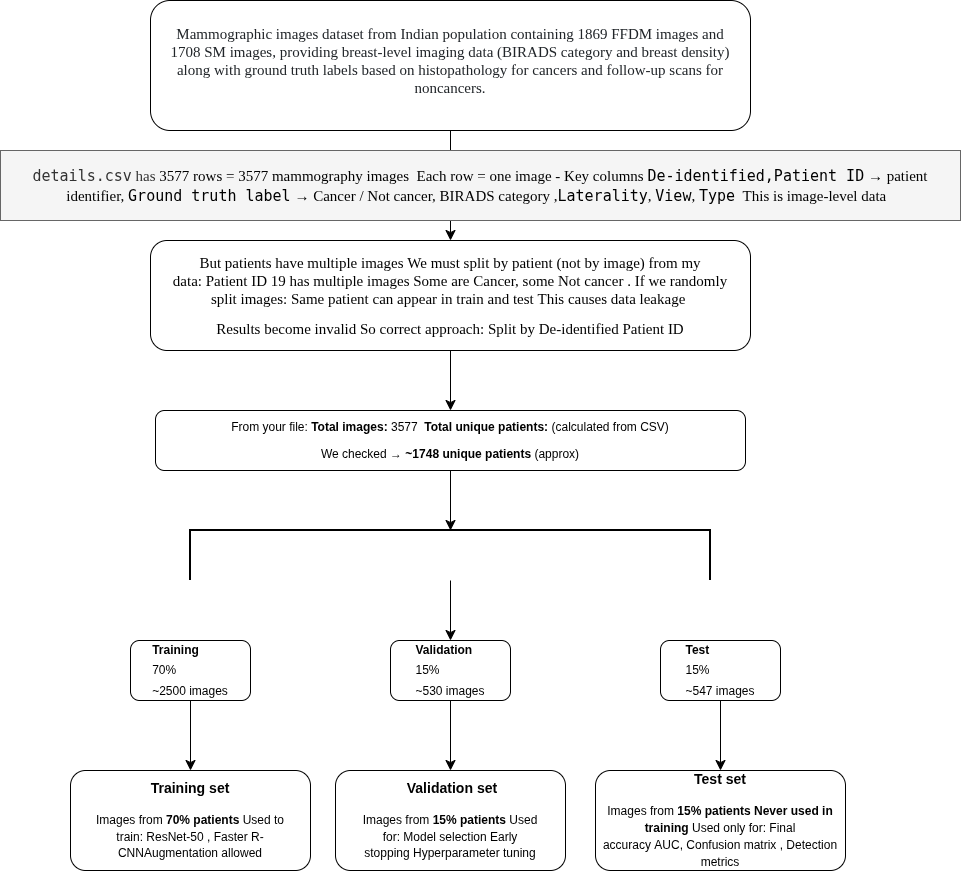
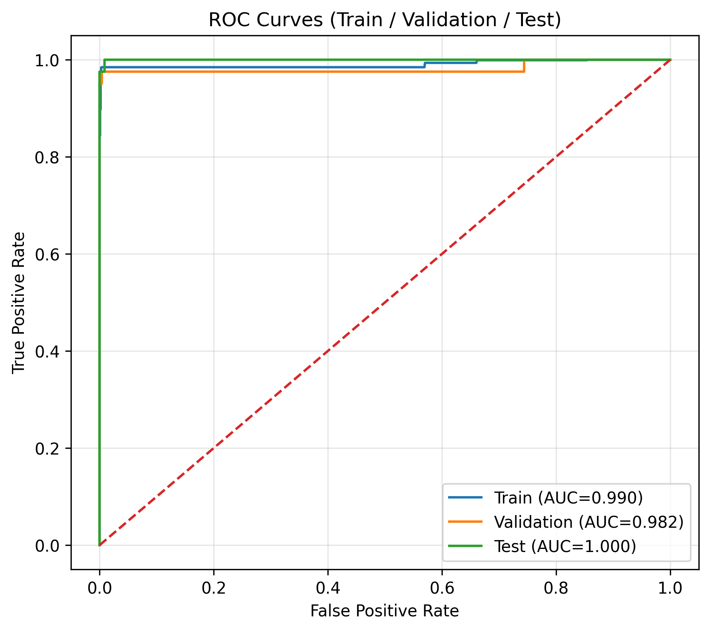
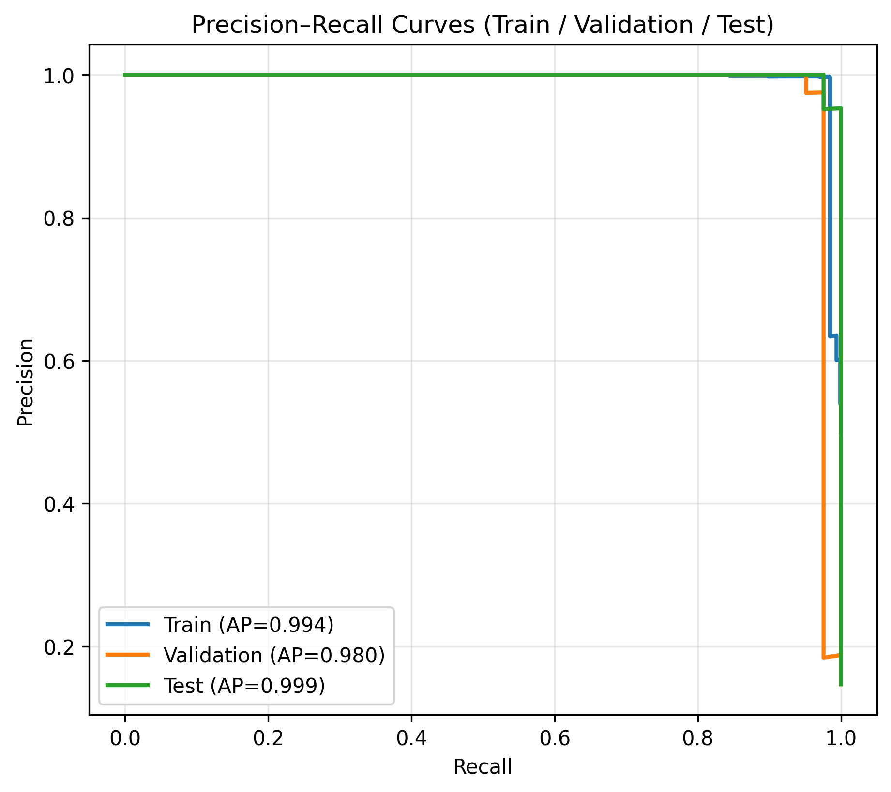
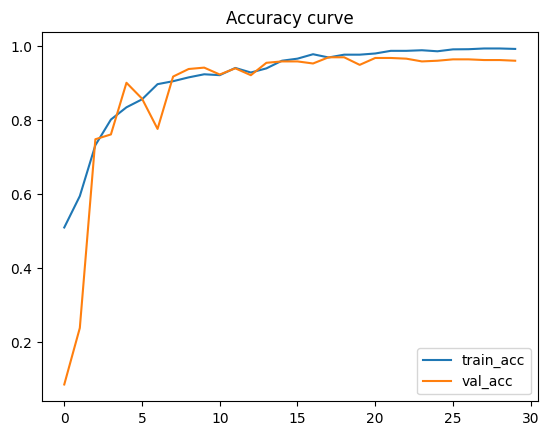
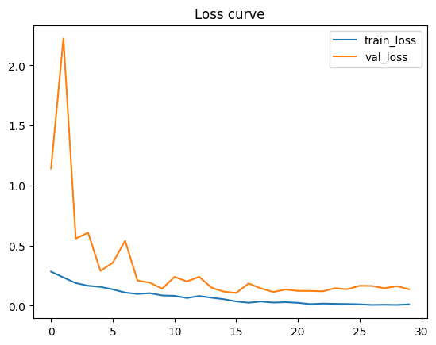
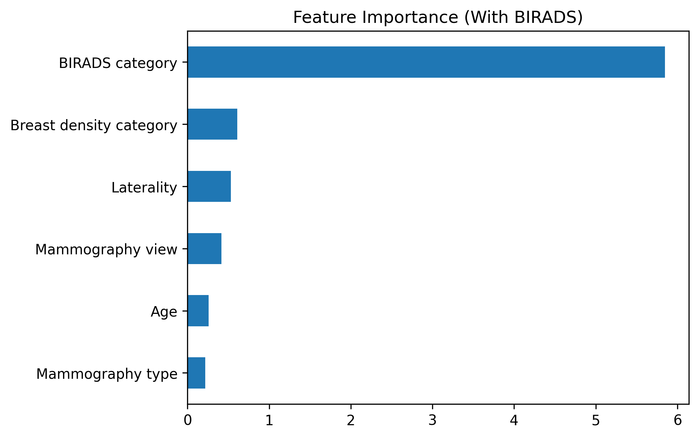
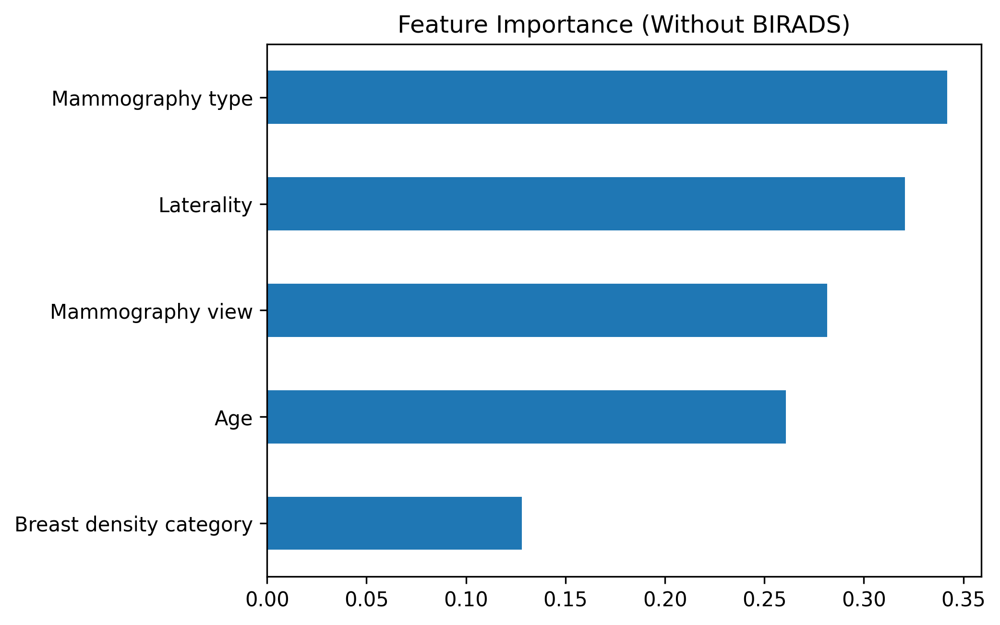

# Deep Learning for Breast Cancer Classification and Tumor Localization in Mammography

M.Sc. Bioinformatics thesis: *Development of a Three-Stage Deep Learning–Based Computer-Aided Diagnosis Software for Breast Cancer Classification and Tumor Localization in Mammography.*

> **Research prototype.** This project is not a medical device and must not be used for clinical decisions. Use only anonymised images with the web app.

**In one sentence:** a deep learning pipeline that classifies mammograms as cancer or not cancer, shows which image regions drove the decision (Grad-CAM), and localizes suspicious regions with an object detector.

**Tools:** Python · PyTorch · TensorFlow/Keras · Faster R-CNN · ResNet-50 · Grad-CAM · Streamlit

---

## Pipeline



1. Image preprocessing and dataset preparation (DICOM converted to PNG)
2. CNN-based classification (ResNet-50)
3. Grad-CAM visualization for interpretability
4. Pseudo bounding boxes generated from activation maps
5. Object detection refinement with Faster R-CNN
6. Evaluation: confusion matrix, ROC curve and precision–recall analysis, with and without BI-RADS clinical information as an input feature

The project also addresses data leakage prevention, overfitting control and the dependence of models on clinical metadata.

## Data

The images come from the **Indian Biological Images Archive (IBIA)** mammography dataset: 3,577 images, about 63 GB.

- **Not included here.** The dataset is too large for this repository. Download it from IBIA and cite it as its page requests.
- **Permission.** Release of anonymised mammography and patient data for external access was permitted by the Dean Research, All India Institute of Medical Sciences (AIIMS), New Delhi (see `aiims_mammo_ethics_statement.pdf`).
- **Preparation.** Three IBIA tables (sample details, image details and labelling) were merged using the sample and experiment IDs. The image path and the label (Cancer / Not Cancer) were kept, DICOM images were converted to PNG, and the data was split 70% train, 15% validation and 15% test.

## Results

Evaluation plots are in [`RESULT/`](RESULT/).

| ROC curves (train, validation, test) | Precision–recall curves (train, validation, test) |
|---|---|
|  |  |

| ResNet-50 training accuracy | ResNet-50 training loss |
|---|---|
|  |  |

| Feature importance with BI-RADS | Feature importance without BI-RADS |
|---|---|
|  |  |

Confusion matrices: [`confusion_matrix_mlp.png`](RESULT/confusion_matrix_mlp.png) and [`confusion_matrix_with_mlp.png`](RESULT/confusion_matrix_with_mlp.png).

## Web app (Streamlit prototype)

An interactive app lets you upload a mammogram and see the pipeline's output.

```bash
git clone https://github.com/livolo/MASTER-s_THESIS.git
cd MASTER-s_THESIS
python -m venv venv && source venv/bin/activate    # Python 3.10
pip install -r requirements.txt
streamlit run webapp.py
```

The pinned versions in `requirements.txt` (TensorFlow 2.12, PyTorch 2.0.1, NumPy 1.23.5) are intended for Python 3.10.

**Model files:**

- `Hybrid CNN/best_hybrid_model_overall.keras` is included in the repository.
- The Faster R-CNN detector weights (`fasterrcnn_pseudo_best.pth`) are **not** included because of their size. Place the file next to `websiteBackend.py`, as set in `load_models()`.

## Repository structure

```text
.
├── webapp.py                         # Streamlit interface
├── websiteBackend.py                 # model loading and inference pipeline
├── start.sh                          # launch script for hosting
├── requirements.txt
├── train_resnet50_upgrade.py         # ResNet-50 training
├── train_faster_rcnn.py              # Faster R-CNN training on pseudo boxes
├── apphybrid.py                      # hybrid pipeline script
├── pseudo_boxes_filtered_clean_v2.csv  # pseudo bounding boxes
├── Hybrid CNN/                       # hybrid model notebooks, saved models, DeLong test, clinical table
├── MODEPREDICT/                      # dataset preparation and evaluation notebooks (with / without BI-RADS)
├── RESULT/                           # evaluation plots
├── flochart_mammogram.drawio.png     # pipeline flowchart
└── aiims_mammo_ethics_statement.pdf  # data release permission
```

## Limitations and future work

- Results come from a single dataset collected in one centre, so they may not carry over to other scanners or populations.
- The models have not been validated clinically.
- Future work: external validation on other datasets, and calibration of the model outputs.

## Author

**Kirti Vishwakarma**, M.Sc. Bioinformatics
[LinkedIn](https://www.linkedin.com/in/kirti-vishwakarma-b69bb9229/) · [GitHub](https://github.com/livolo)